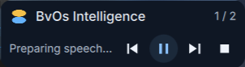

# BvOs Intelligence Read Aloud

 

Read selected or copied text on Omarchy using the local Kokoro speech engine. A frameless strip opens in the upper-right corner of the active screen and follows you across workspaces. Hover to reveal the playback controls and scrollable text preview, or click and hold anywhere on the top strip to drag it. The card follows Omarchy’s light or dark theme using the BVOS palette and updates its corner radius when Hyprland’s rounding changes.

| Action | Shortcut |
| --- | --- |
| Start reading or resume playback | Ctrl + Up or click the header’s play icon when a passage is loaded |
| Pause | Ctrl + Down or click the green waveform |
| Previous or next sentence | Ctrl + Left / Right |
| Read a new selection, with clipboard fallback | Super + Shift + R |
| Read the clipboard directly | Super + Alt + R |
| Adjust window opacity (with the BVOS opacity plugin) | Hover and click ◐ |
| Close the card | Hover and click ×, or press Esc when the player has focus |

## Install

On Omarchy Quattro with Lua-based Hyprland, add the bar widget from the [Omarchy Marketplace](https://plugins.omarchy.org/plugin.html?id=blueview.read-aloud) or run:

```sh
omarchy plugin add https://github.com/frank-blueview-ai/bvos-read-aloud-omarchy.git --enable
```

If you already have the widget, run `omarchy plugin update blueview.read-aloud` to get the setup command.

Then run setup from an Omarchy terminal:

```sh
"${XDG_CONFIG_HOME:-$HOME/.config}/omarchy/plugins/blueview.read-aloud/bin/setup"
```

Setup installs missing system packages through Pacman, builds the player for your account, adds the desktop launcher, and backs up your Hyprland bindings before adding shortcuts. It reuses a compatible Kokoro installation from Blue View Local Chat or an earlier standalone setup. If neither is available, accept the prompt to download the voice and enable speech.

To install without the bar widget, clone this repository and run `./bin/setup` from the checkout.

Voice setup installs an isolated Python 3.13 environment and downloads about 354 MB of model and voice data from [kokoro-onnx](https://github.com/thewh1teagle/kokoro-onnx). It checks both downloads against pinned SHA-256 hashes before installing them. Kokoro's model is [Apache 2.0 licensed](https://huggingface.co/hexgrad/Kokoro-82M/blob/main/LICENSE), and the model files are downloaded separately. The player and widget are MIT licensed.

## Use Read Aloud

Press **Ctrl + Up** after copying a sentence. Middle-click the bar widget to read a selection or right-click it to read the clipboard. Click the double oval in the card or the bar to visit [Blue View](https://blueview.ai). The player passes text to the local worker over stdin and keeps the current sentence's audio in memory. It uses no remote speech API.

On opening, Ctrl+Up prefers copied text when both a copy and a selection are available. While the card is open, a new plain-text copy replaces the passage and resets playback to the beginning. The preview renders Markdown headings, lists, links, emphasis, and code, and follows the highlighted sentence during playback. Choose Edit to change the source, then press Ctrl+Up to read the edited passage. The speech engine skips code and formatting symbols. Edits stay in the player. Ctrl+Down, Ctrl+Left, and Ctrl+Right are captured only while the playback card is open. Ctrl+Up is the global start shortcut.

By default the worker is loaded from Blue View Local Chat's XDG data directory when available, or from `$XDG_DATA_HOME/omarchy-read-aloud/speech` for a standalone setup. The default XDG data directory is `~/.local/share`. If you set `BLUE_VIEW_ASSET_DIR`, the player uses its `speech` subdirectory.

## Development

Run `./bin/build` to compile and `omarchy plugin validate .` to validate the plugin. Test from an Omarchy terminal with `./build/omarchy-read-aloud --text "First sentence. Here is another."`

To remove the player, remove its binary, desktop entry, icon, and `~/.config/hypr/read-aloud.lua` and delete the marked **Blue View Read Aloud** block from your Hyprland bindings. Reload Hyprland, then use `omarchy plugin remove blueview.read-aloud` if you installed the bar button. To remove the standalone model and Python environment, remove the `omarchy-read-aloud/speech` directory from your XDG data directory.
