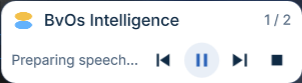
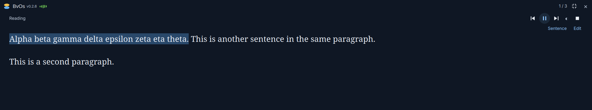
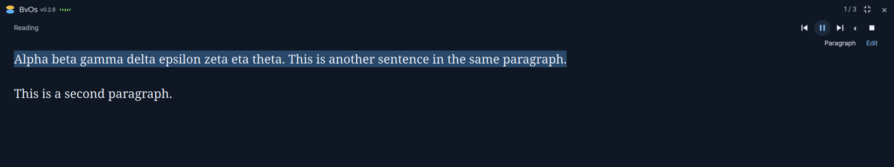
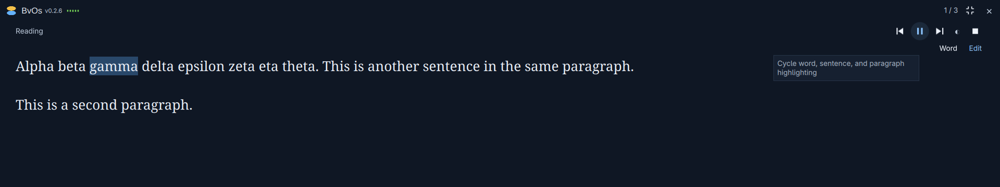

# BvOs Intelligence Read Aloud

 

Read selected or copied text on Omarchy using the local Kokoro speech engine. A frameless strip opens in the upper-right corner of the active screen and follows you across workspaces. Hover to reveal the playback controls and scrollable text preview, or click and hold anywhere on the top strip to drag it. The card follows Omarchy’s light or dark theme using the BVOS palette and updates its corner radius when Hyprland’s rounding changes.

| Action | Shortcut |
| --- | --- |
| Start reading or resume playback | Ctrl + Up or click the header’s play icon when a passage is loaded |
| Pause | Ctrl + Down or click the playback indicator |
| Previous or next sentence | Ctrl + Left / Right |
| Read a new selection, with clipboard fallback | Super + Shift + R |
| Read the clipboard directly | Super + Alt + R |
| Enter fullscreen | Hover over the card and click the four-corner icon beside × |
| Return to the card | Click the same icon or press Esc in fullscreen |
| Switch highlight mode in fullscreen | Click the mode name beside Edit |
| Adjust window opacity (with the BVOS opacity plugin) | Hover and click ◐ |
| Close the player | Click ×, or press Esc while the compact card has focus |

## Standalone desktop preview

See [GitHub Releases](https://github.com/frank-blueview-ai/bvos-read-aloud-omarchy/releases) for available standalone packages. The desktop app opens as a regular, resizable window. With a passage loaded, use the fullscreen and highlighting controls described below.

On Debian 13 (amd64), download the `.deb` and install it from the directory where you saved it:

```sh
sudo apt install ./bvos-read-aloud_0.2.6_amd64.deb
```

Open **BvOs Intelligence Read Aloud** from your app menu. Choose **Set Up Kokoro Voice** and confirm the one-time download of about 354 MB. The installer includes the speech runtime. After the model download, the app can read offline. Use **Read Clipboard** to read text you copied, or **Paste Text…** to paste or type a passage. The standalone app reads the clipboard when you ask it to.

The desktop packaging workflow also defines a Windows 11 x64 installer and a macOS development disk image. Platform support requires testing the installed package on that OS. The macOS development image requires Developer ID signing and notarization before public distribution.

## Install on Omarchy

On Omarchy Quattro with Lua-based Hyprland, add the bar widget from the [Omarchy Marketplace](https://plugins.omarchy.org/plugin.html?id=blueview.read-aloud) or run:

```sh
omarchy plugin add https://github.com/frank-blueview-ai/bvos-read-aloud-omarchy.git --enable
```

If you already have the widget, run `omarchy plugin update blueview.read-aloud`, then run setup again to rebuild the player. The installed version appears beside **BvOs** and is also available from `~/.local/bin/omarchy-read-aloud --version`.

Then run setup from an Omarchy terminal:

```sh
"${XDG_CONFIG_HOME:-$HOME/.config}/omarchy/plugins/blueview.read-aloud/bin/setup"
```

Setup installs missing system packages through Pacman, builds the player for your account, adds the desktop launcher, and backs up your Hyprland bindings before adding shortcuts. It reuses a compatible Kokoro installation from Blue View Local Chat or an earlier standalone setup. If neither is available, accept the prompt to download the voice and enable speech.

To install without the bar widget, clone this repository and run `./bin/setup` from the checkout.

Voice setup installs an isolated Python 3.13 environment and downloads about 354 MB of model and voice data from [kokoro-onnx](https://github.com/thewh1teagle/kokoro-onnx). It checks both downloads against pinned SHA-256 hashes before installing them. Kokoro's model is [Apache 2.0 licensed](https://huggingface.co/hexgrad/Kokoro-82M/blob/main/LICENSE), and the model files are downloaded separately. The player and widget are MIT licensed.

## Use Read Aloud

Press **Ctrl + Up** after copying a sentence. Middle-click the bar widget to read a selection or right-click it to read the clipboard. Click the double oval in the card or the bar to visit [Blue View](https://blueview.ai). The player passes text to the local worker over stdin and keeps the current sentence's audio in memory. It uses no remote speech API.

On opening, Ctrl+Up prefers copied text when both a copy and a selection are available. While the card is open, a new plain-text copy replaces the passage and resets playback to the beginning. The preview renders Markdown headings, lists, links, emphasis, and code, and follows the active highlight during playback. Choose Edit to change the source, then press Ctrl+Up to read the edited passage. The speech engine skips code and formatting symbols. Edits stay in the player. Ctrl+Down, Ctrl+Left, and Ctrl+Right are captured only while the playback card is open. Ctrl+Up is the global start shortcut.

By default the worker is loaded from Blue View Local Chat's XDG data directory when available, or from `$XDG_DATA_HOME/omarchy-read-aloud/speech` for a standalone setup. The default XDG data directory is `~/.local/share`. If you set `BLUE_VIEW_ASSET_DIR`, the player uses its `speech` subdirectory.

## Fullscreen reading and highlighting

1. Load a passage and hover over the floating card to show its controls.
2. Click the four-corner icon next to **×**. The preview fills the monitor, with larger serif text and more space between lines and paragraphs. Markdown headings, lists, and emphasis remain visible.
3. Click **Sentence** next to **Edit** to cycle through **Sentence → Paragraph → Word → Sentence**. The button always shows the active mode. You can switch while reading or paused.
4. Click the fullscreen icon again or press **Esc** to return to the card at its original position. Playback continues through either transition.

| Mode | What follows the audio |
| --- | --- |
| Sentence | The current spoken sentence. This is the default. |
| Paragraph | The formatted paragraph containing the current spoken sentence. |
| Word | An estimated current word within the spoken sentence. The highlight advances with audio playback and holds its position when paused. Kokoro does not supply word timestamps, so the highlight can lead or lag the voice. |

### Sentence mode



### Paragraph mode



### Word mode



## Development

Run `./bin/build` to compile the Omarchy player and `omarchy plugin validate .` to validate the plugin. Test from an Omarchy terminal with `./build/omarchy-read-aloud --text "First sentence. Here is another."`

### Build on Windows

In an x64 Visual Studio developer shell, put Qt 6.8 for MSVC 2022 (including Qt Multimedia) and Python 3.13 x64 on PATH. Install Inno Setup 6 in its default location. From the repository, run:

```powershell
pwsh -File packaging/windows.ps1
```

The script builds the standalone app, bundles the speech worker, and writes the installer to `artifacts/`.

On Debian, remove the standalone app with `sudo apt remove bvos-read-aloud`. Voice files live in `${XDG_DATA_HOME:-$HOME/.local/share}/bvos-read-aloud/speech` and can be deleted separately.

To remove the Omarchy player, remove its binary, desktop entry, icon, and `~/.config/hypr/read-aloud.lua` and delete the marked **Blue View Read Aloud** block from your Hyprland bindings. Reload Hyprland, then use `omarchy plugin remove blueview.read-aloud` if you installed the bar button. To remove the standalone model and Python environment, remove the `omarchy-read-aloud/speech` directory from your XDG data directory.
